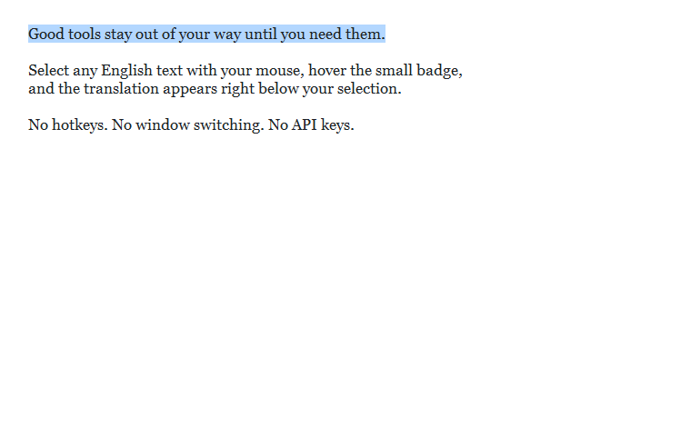
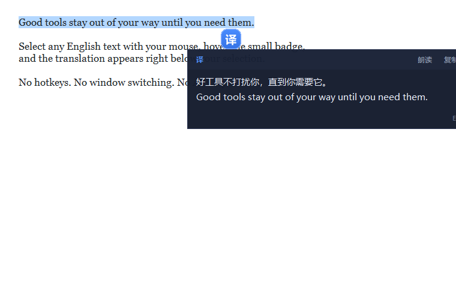
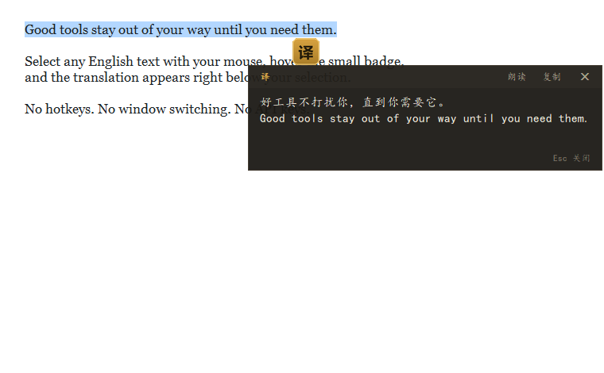
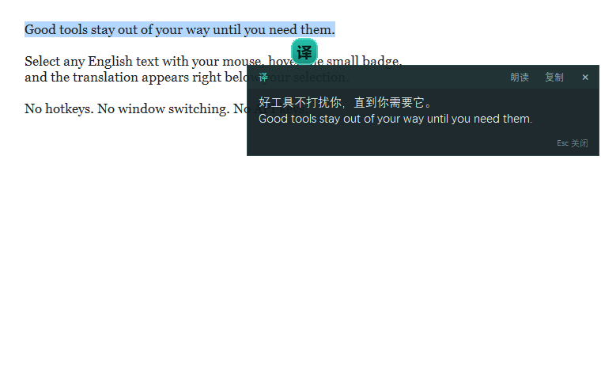
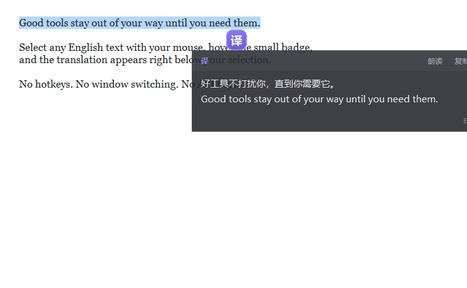
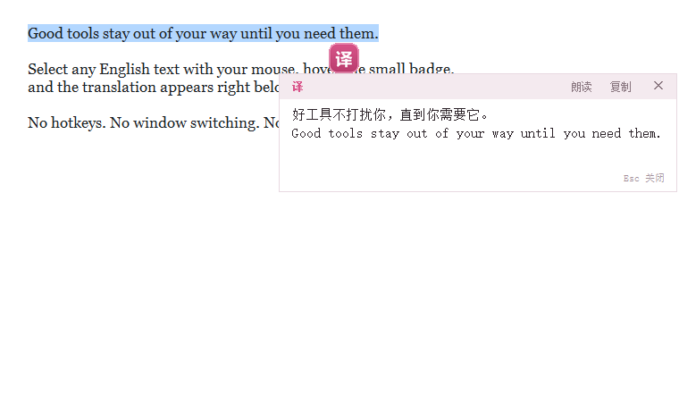

# screen-translate · 划词翻译

[](LICENSE)
[](https://github.com/rallait/screen-translate)
[](https://github.com/rallait/screen-translate)
[](https://github.com/rallait/screen-translate/releases)



一个 Windows 桌面端的全局划词翻译小工具：**鼠标拖选英文 → 悬停「译」图标 → 译文浮现在选区右下方**，不用切窗口、不用按快捷键。

免 API 密钥，开箱即用；支持双语对照、英文朗读、截图 OCR 和 5 套可即时切换的视觉主题。

## English

**screen-translate** is a Windows hover-translate tool: drag-select any English text, hover the floating "译" icon, and the translation pops up right below your selection — no hotkeys, no window switching.

- Key-free translation (Youdao demo endpoint with MyMemory fallback, auto retry)
- Smart mixed-language handling: pure Chinese is left alone, English segments translate in place
- Bilingual mode (translation + original), English TTS, screenshot OCR
- 5 instantly-switchable themes (colors + fonts + animations), tray resident, single instance
- Grab the ready-to-run exe from [Releases](https://github.com/rallait/screen-translate/releases), or run from source with Python 3.9+

中文文档 ↓

## 特性

- **拖选即译**：拖动超过 25px 自动取词，选区旁出现「译」圆标，鼠标移上去才发请求，避免误触浪费额度
- **智能免打扰**：纯中文不弹图标；中英混排只翻英文段，中文与全角标点原位保留
- **无字数上限**：长文本按 800 字分块并发请求，按序拼接
- **免密钥翻译源**：有道演示接口为主、MyMemory 兜底，失败自动降级，限流退避重试
- **双语对照**：译文下方附英文原文，可随时开关
- **朗读英文**：调用 Windows 自带语音，只念英文片段
- **截图翻译**：框选屏幕区域做 OCR（支持 RapidOCR，缺失时自动用 Windows 自带 OCR）
- **5 套主题**：午夜蓝 / 曜石金 / 极光青 / 磨砂紫 / 樱雾白，每套含独立配色、字体、入场动画和译文呈现方式，**选中即生效**
- **常驻托盘**：单实例运行、开机自启、快捷键可改

## 环境要求

- Windows 10 / 11
- Python 3.9+（开发环境为 3.15）

## 安装与运行

```bash
pip install -r requirements.txt
python auto_translate.py
```

想让它后台静默运行（不显示控制台），用 `pythonw auto_translate.py` 启动；程序也会自动隐藏自己独占的控制台窗口。

## 主题预览

| 午夜蓝 | 曜石金 | 极光青 |
| --- | --- | --- |
|  |  |  |

| 磨砂紫 | 樱雾白 |
| --- | --- |
|  |  |

## 使用

1. 在任意应用里用鼠标拖选一段英文（或中英混排文字）
2. 选区旁出现「译」圆标，鼠标移上去
3. 译文窗出现在选区右下方，可复制、朗读

| 快捷键 | 作用 |
| --- | --- |
| 鼠标拖选 | 取词并显示「译」图标 |
| `Esc` | 关闭当前结果窗 |
| `Ctrl + Alt + S` | 截图翻译（框选区域 OCR） |
| `Ctrl + Alt + Q` | 退出程序 |

右键托盘图标可打开**设置**（翻译源、字号、主题、双语对照、图标大小、开机自启、快捷键），也可直接切换到任意主题。结果窗标题栏和「译」圆标上右键同样能换主题。

## 打包为 exe

```bash
pip install -r requirements-dev.txt
pyinstaller screen-translate.spec
```

产物在 `dist/screen-translate.exe`，单文件、无控制台。

## 项目结构

| 文件 | 职责 |
| --- | --- |
| `auto_translate.py` | 主程序：全局钩子、任务队列、托盘、设置应用、自检 |
| `ui.py` | 界面层：主题表、悬浮图标、结果窗、设置窗、截图遮罩 |
| `translator.py` | 翻译引擎：多源降级、分块并发、LRU 缓存 |
| `ocr.py` + `ocr_winrt.ps1` | 截图 OCR |
| `tts.py` | 英文朗读 |
| `config.py` | 配置读写与路径管理 |

## 运行数据

配置、日志、缓存都在 `%APPDATA%\hxy-translate\`：

- `config.json` 配置
- `app.log` 运行日志（滚动保留 3 份）
- `cache.json` 翻译缓存

删除该目录即可恢复默认设置。

## 自检

```bash
python auto_translate.py --selftest
```

检查窗口渲染、主题切换、双语对照、朗读取词等链路，输出 JSON 结果后退出。

## 说明与限制

- 翻译接口为公开免费接口，可能有频率限制；请求失败会自动重试并降级到备用源
- 机器翻译结果仅供参考，专业场景请自行校对
- 截图 OCR 依赖系统 OCR 能力，建议 Windows 10 及以上并安装对应语言包

## 许可证

[MIT](LICENSE)
